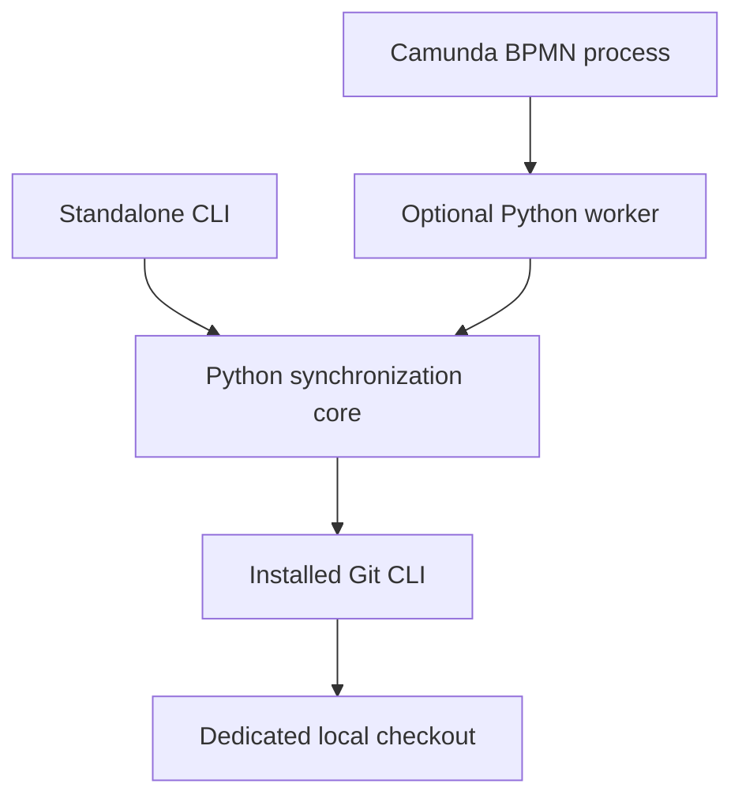

# Git Upstream Synchronizer

A small Python tool that safely fast-forwards a local Git checkout from a configured
upstream remote. It also demonstrates a real BPMN 2.0 Service Task and external
Python worker for a Camunda 8 technical interview.

**Camunda is optional.** The synchronization engine and standalone CLI work without
Camunda packages, Docker, or a proprietary service. This is an interview proof of
concept and a foundation for a useful standalone tool, not a production platform.

## Architecture



- `sync.py` accepts a path, branch, and configured remote; returns a frozen
  `SyncResult`; and raises meaningful precondition or Git-operation exceptions.
- `cli.py` translates command-line arguments and prints JSON.
- `camunda_worker.py` alone handles SDK jobs, local repository configuration,
  process-variable translation, and retries. It calls the same core function.
- `scripts/demo.py` creates disposable Git fixtures and can drive either adapter.

There is no plugin registry, framework, database, or asynchronous code in the core.
A scheduler or another workflow engine can call the function or CLI directly.

| Result | Meaning | Local branch effect |
| --- | --- | --- |
| `UPDATED` | Local HEAD is an ancestor of upstream | Fast-forward to fetched commit |
| `UP_TO_DATE` | Both commits are equal | None |
| `NEEDS_REVIEW` | Local branch is ahead, diverged, or unrelated | None |

Fetching updates Git metadata, including `FETCH_HEAD` and potentially remote-tracking
refs; it does not promise a byte-for-byte unchanged `.git` directory. No operation
pushes, rebases, resets, force-updates, or creates a merge commit.

## Standalone installation and use

Requires Linux, Python 3.11+, and Git 2.31+ (`--path-format` support). From the
repository root:

```bash
python3 -m venv .venv
.venv/bin/python -m pip install -e .
.venv/bin/git-upstream-sync /absolute/path/to/fork --branch main --upstream upstream
```

The remote must already be configured in that checkout. JSON output contains
`status`, `previous_sha`, `upstream_sha`, and `current_sha`. Exit codes are 0 for
`UPDATED`/`UP_TO_DATE`, 2 for `NEEDS_REVIEW`, and 1 for precondition/technical
failures (error JSON on stderr). Invalid command-line syntax also exits with 2.

Direct Python reuse needs no execution backend:

```python
from pathlib import Path
from git_upstream_synchronizer import synchronize_repository

result = synchronize_repository(Path("/absolute/path/to/fork"))
print(result.status, result.current_sha)
```

The engine refuses dirty or detached worktrees, unfinished Git operations, invalid
branch names, arbitrary remote URLs in place of configured names, and overlapping
calls from this tool. It preserves ignored files that conflict with incoming files.
Before fetching, it also refuses Git's index, HEAD, selected-branch, and packed-refs
lock files. A Git lock can indicate an active command or an interrupted write;
the tool preserves it and requires operator inspection.

A nonblocking Linux advisory lock covers the operation. The held descriptor is
passed explicitly to `git fetch` and `git merge`, so a surviving Git child retains
the lock if Python is killed. Another synchronization refuses to start until the
child releases it. Linux releases the lock when its last inherited descriptor
closes; the lock file itself can remain on disk. Do not delete that file to bypass
an active lock. Other Git applications do not honor it: use a dedicated checkout
and avoid manual changes while synchronization is running. Repositories and their
Git configuration/hooks must be trusted; this tool is not a sandbox.

## Optional Camunda environment

Pinned versions: **Camunda Run 8.9.26**, **official Python SDK 9.0.1**. SDK major 9
matches the 8.9 server API. See the [official SDK versioning guidance](https://github.com/camunda/orchestration-cluster-api-python).

[Camunda Run](https://docs.camunda.io/docs/8.9/self-managed/quickstart/developer-quickstart/c8run/)
and [Docker Compose](https://docs.camunda.io/docs/8.9/self-managed/quickstart/developer-quickstart/docker-compose/)
both support a lightweight H2 setup. Run was selected to avoid image pulls,
container networking, and mounts between the Python worker and its Git checkout.
The official archive includes Connectors, which this process does not use. No
separate Elasticsearch, SQL server, or Docker daemon is needed.

The Linux x86_64 archive is approximately 807 MB; the extracted installation is
about 1 GB. The installer requires 5 GB free disk for download/extraction headroom,
verifies the published SHA-256, and reuses an existing installation. Runtime data
and logs accumulate under the ignored `infra/camunda/` directory.

```bash
.venv/bin/python -m pip install -e '.[dev,camunda]'
sudo apt-get install --no-install-recommends openjdk-21-jre-headless
bash scripts/install-camunda.sh
```

Java 21 is the tested runtime. Start from the distribution directory; use the
relative config path because this launcher incorrectly prefixes absolute paths:

```bash
cd infra/camunda/c8run-8.9.26
export JAVA_HOME=/usr/lib/jvm/java-21-openjdk-amd64
export SERVER_ADDRESS=127.0.0.1
export CAMUNDA_CLIENT_GRPCADDRESS=http://127.0.0.1:26500
export CAMUNDA_CLIENT_RESTADDRESS=http://127.0.0.1:8080
export JAVA_OPTS='-Xms128m -Xmx768m -XX:ActiveProcessorCount=2'
./c8run start --config ../../application.yaml
```

The HTTP, gRPC, management, and broker listeners are restricted to loopback.
The two Java client addresses connect the bundled Connectors to that address.
Do not export `MANAGEMENT_SERVER_ADDRESS` globally: Connectors shares its main
HTTP port for management; the core's separate management address is set in YAML.
The SDK worker uses the REST API and has its own environment settings below.

Operate is at <http://127.0.0.1:8080/operate>, with local development credentials
`demo` / `demo`. The REST API is intentionally unauthenticated in this loopback-only
setup. For access from a different computer, use an SSH tunnel rather than
changing the bind address. Never publish these development ports publicly.

```bash
curl --fail http://127.0.0.1:8080/v2/topology
ss -ltn
```

Stop from the distribution directory with `./c8run stop`. Wait for ports to close
before starting again; this version's launcher can return before port release.

## Reproducible demonstration

With the runtime running, from the project root:

```bash
.venv/bin/python scripts/demo.py --camunda
```

Stop any manual demo worker before running the automated demonstration: all workers
for this job type must agree on the repository-ID mapping.

The two automated Camunda demonstrations share a nonblocking local guard at
`infra/camunda/demonstration.lock`. A second run from this checkout exits with a
clear message before deploying or starting a worker. Workers inherit the held
descriptor, so a surviving worker keeps the guard if its launcher dies. Once all
holders exit, another run can start even though the file remains. Do not delete
the file to bypass a running demo. This guard covers one checkout; manual workers,
other checkouts, and other machines still require coordination. The standalone
demonstration and `--prepare` mode remain available while a Camunda demo runs.

Each run creates new repositories under a printed `/tmp/git-sync-demo-*` directory.
It deploys the BPMN file, launches a separate Python worker, starts process instances,
and asserts the following observable effects:

1. `UPDATED`: the fork's HEAD advances and `upstream.txt` appears.
2. `UP_TO_DATE`: repeating synchronization preserves HEAD.
3. `NEEDS_REVIEW`: independent commits are preserved; the fork's HEAD is unchanged.
4. Temporary fetch failure: two retries remain after the first failure; restoring
   the remote lets Camunda retry automatically and complete the same instance.
5. Persistent fetch failure: three attempts exhaust retries and create an active
   incident; no result status is falsely returned and HEAD remains unchanged.
6. Git write lock: an isolated `index.lock` causes an immediate zero-retry incident.
   HEAD and the lock contents are preserved. After removing its own synthetic
   fixture, the demonstration starts a new instance that completes as `UP_TO_DATE`.

The script checks the three named BPMN end events through the API. `worker.log`
and `report.json` remain in the printed directory for inspection. Its worker stops
on completion; the incidents remain visible in Operate. Git fixture commits
are intentionally unsigned and isolated; implementation commits are signed.

The standalone demonstration needs no Camunda SDK:

```bash
.venv/bin/python scripts/demo.py
```

### Worker crash recovery

With the same local runtime running, stop other demonstration workers and run:

```bash
.venv/bin/python scripts/demo_crash_recovery.py
```

This creates fresh local fixtures and starts a fault-injection worker that calls
the production job handler. After Git returns `UPDATED`, that worker exits abruptly
with `os._exit(23)` before the SDK can send job completion. The script observes
`TIMED_OUT` with all three retries remaining, then starts the normal worker.
The same job completes as `UP_TO_DATE`, reaches `EndUpToDate`, and leaves HEAD
and the commit count unchanged. No incident is expected for this successful recovery.

The fault worker uses a 15-second activation timeout to keep this demonstration
short. The normal worker retains its ten-minute timeout. The script saves the
before-crash receipt, both worker logs, and `report.json` in its printed temporary
directory. It cancels its process instance if verification fails.

This Camunda demonstration verifies a crash after the Git effect and before job
completion. Separate core tests interrupt a real checkout after one file is written
but before the index and branch are updated. A repeat call preserves the partial
files and Git lock and requires operator inspection. Ref replacement, power loss,
and lost responses after Camunda accepts completion remain unverified.
No fault-injection behavior is installed in the core or normal worker.

### Manual demonstration: deploy, run the worker, start an instance

Prepare new fixtures. Choose another directory name if it already exists:

```bash
.venv/bin/python scripts/demo.py --prepare --directory /tmp/git-sync-interview
```

In terminal A, from the project root:

```bash
export CAMUNDA_REST_ADDRESS=http://127.0.0.1:8080/v2
export CAMUNDA_AUTH_STRATEGY=NONE
.venv/bin/git-upstream-worker --repositories /tmp/git-sync-interview/repos.json
```

In terminal B, deploy the model and start one instance:

```bash
export CAMUNDA_REST_ADDRESS=http://127.0.0.1:8080/v2
export CAMUNDA_AUTH_STRATEGY=NONE
.venv/bin/python - <<'PYTHON'
from camunda_orchestration_sdk import (
    CamundaClient, ProcessCreationById, ProcessInstanceCreationInstructionByIdVariables,
)
with CamundaClient() as client:
    client.deploy_resources_from_files(['bpmn/synchronize-repository.bpmn'])
    instance = client.create_process_instance(data=ProcessCreationById(
        process_definition_id='git-upstream-sync',
        variables=ProcessInstanceCreationInstructionByIdVariables.from_dict(
            {'repository_id': 'demo'}),
    ))
    print('Process instance:', instance.process_instance_key)
PYTHON
```

Observe the log in terminal A, open the instance in Operate, and inspect the fork:

```bash
git -C /tmp/git-sync-interview/fork log -3 --oneline
cat /tmp/git-sync-interview/fork/upstream.txt
```

Run the start command again for `UP_TO_DATE`. Use the automated demonstration for
all divergence and failure assertions. Open `bpmn/synchronize-repository.bpmn` in
Desktop Modeler to inspect or deploy the same model graphically.

To configure a dedicated checkout, copy `config/repos.example.json` to the ignored
`config/repos.json` and edit the absolute path with `vi`. The worker accepts only
`repository_id`; paths, remote names, and branches come from the trusted local
allowlist. Restart the worker after changing the allowlist.

## Errors, retries, and idempotency

The adapter follows the [official SDK worker behavior](https://docs.camunda.io/docs/8.9/apis-tools/python-sdk/job-workers/)
and [Camunda job activation semantics](https://docs.camunda.io/docs/8.9/components/concepts/job-workers/).

Business results are normal task completions. Divergence is `NEEDS_REVIEW`, not a
technical exception: the gateway reaches its review end event without modifying
history. No default gateway flow is defined; an unexpected result causes an
incident rather than silently treating it as success.

`GitCommandError` reports failed Git execution, including fetch/network problems,
command timeouts, and lock contention. The adapter raises SDK `JobFailure` with a
five-second retry backoff and leaves the SDK to decrement the current retry count.
The BPMN task starts with three retries: this permits three failed attempts in total.
Zero retries creates an incident. Operators inspect the error, fix the cause, restart
the worker if needed, and retry/resolve the incident in Operate. Retrying unchanged
bad credentials or a permanently missing remote cannot fix the underlying problem.

`SyncError` identifies unsafe input/state, such as a dirty checkout, a Git write
lock, or an unknown repository ID. The worker fails that job with zero retries
for operator attention. Git locks are never removed automatically.
Unexpected exceptions escape to the SDK, which fails the job and decrements retries
with its default backoff (zero). Failures are never translated into success statuses.

Each Git subprocess has a 30-second timeout while its Python caller is running;
interactive Git terminal prompts are disabled. Credential helpers/SSH must be
configured for unattended operation. If Python is killed, its timeout logic stops.
An orphan Git process or helper retaining the lock can therefore block later calls
until it finishes or an operator stops it. Lock contention remains a technical
failure handled by the existing retry/incident policy.
The worker activates one job at a time, in the SDK's thread strategy, with a ten-minute
job timeout. This keeps blocking Git calls outside the SDK's polling loop and gives
the series of bounded commands time to finish.

If a worker dies before acknowledging a job, Camunda can reactivate it after the
job timeout; timeout alone does not decrement retries. Repeating the core call is
safe: equality returns `UP_TO_DATE`, and divergent histories are never merged.
A crash after the fast-forward but before job completion can therefore change a
redelivery result from `UPDATED` to `UP_TO_DATE`. There is no atomic transaction
between Git and Camunda, and no claim of exactly-once execution.

## Tests and verified scope

```bash
.venv/bin/python -m pip install -e '.[dev]'
.venv/bin/python -m pytest -q
```

Core and CLI tests use temporary local repositories and work without the SDK;
worker tests automatically skip unless the optional SDK is installed. With
`.[dev,camunda]` installed, all adapter tests run without contacting a server.
The end-to-end demonstration is explicit and separate from ordinary pytest runs.
The focused safety checks run without a server. Core crash tests need no SDK;
the demo guard suite skips its crash-script entry-point check when the SDK is absent:

```bash
.venv/bin/python -m pytest -q tests/test_safety.py -k killed_sync
.venv/bin/python -m pytest -q tests/test_interrupted_checkout.py
.venv/bin/python -m pytest -q tests/test_demo_lock.py
```

See [verification evidence](docs/verification.md) for what was actually tested,
and [architecture and design rationale](docs/interview.md) for the five interview questions.

## Trade-offs and production considerations

A standalone script with cron or a systemd timer is sufficient for periodic updates
of a few repositories. Camunda becomes useful when synchronization is one step of
a longer business process that needs durable state, visible branching, coordinated
retries, incident handling, or human decisions. Those benefits bring a Java runtime,
workflow operations, resource usage, and an additional licensing dependency.

Camunda Run and H2 are development tools, not the production design for this
application. Camunda's compiled orchestration components use proprietary licenses;
production use requires the appropriate commercial license under the
[official licensing terms](https://docs.camunda.io/docs/8.9/reference/licenses/).
The standalone tool has no Camunda runtime or SDK dependency.

Production work would require authenticated/authorized process access, a least-
privileged worker, managed Git credentials, secrets kept out of remote URLs and
logs, protected checkout ownership, monitored incidents, durable runtime backups,
resource limits and log retention. Multi-host workers need shared checkout/locking
semantics designed explicitly. The local advisory lock only coordinates this tool
on a filesystem that supports Linux `flock` semantics.

Remote pushes, conflict resolution, bare-repository updates, submodule updates,
LFS downloads, verification of upstream commit signatures, and multi-host execution
are outside the implemented scope. There is no web frontend, scheduler, or approval
workflow. Additional features should follow concrete operating requirements.
